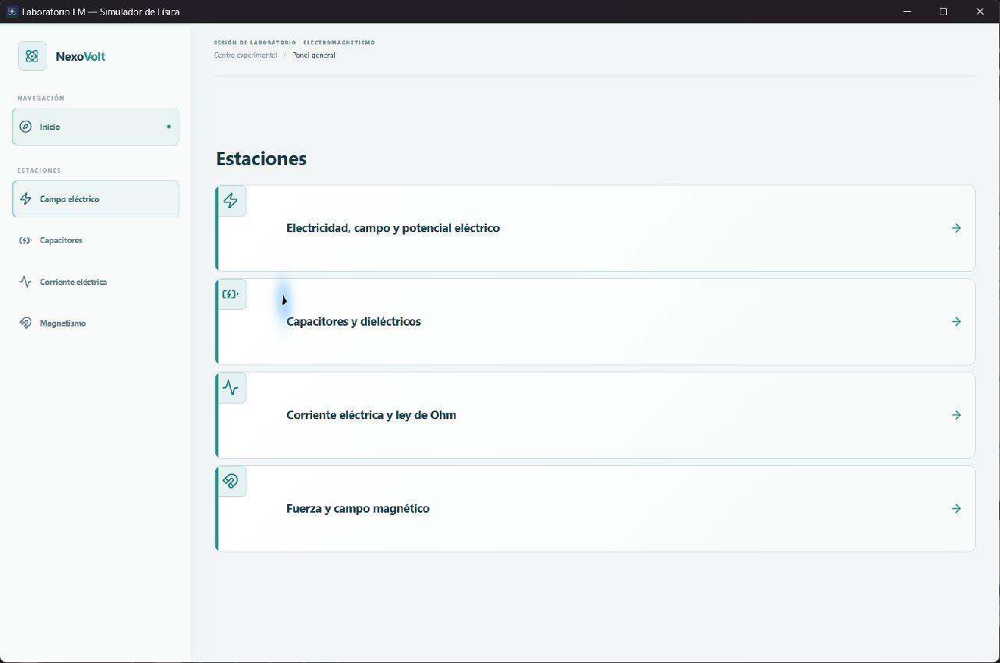
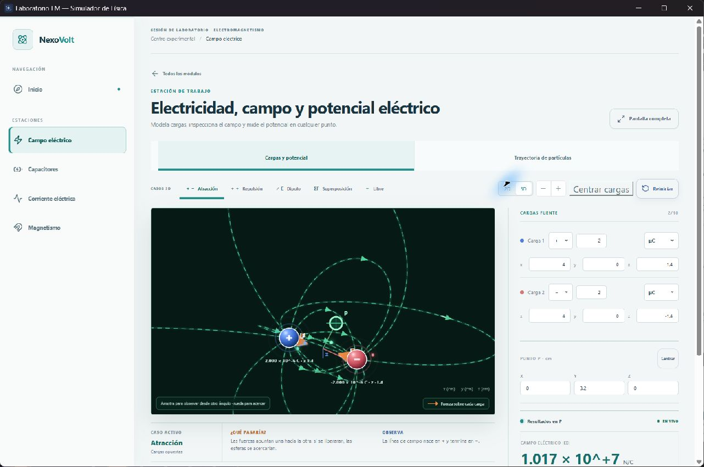
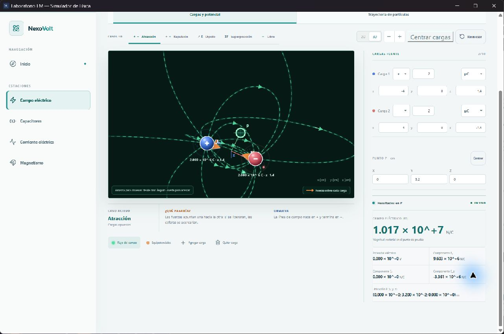
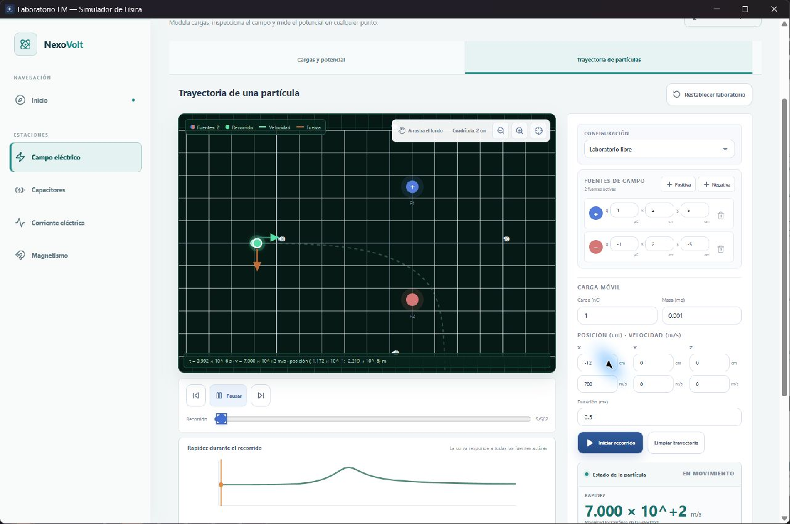
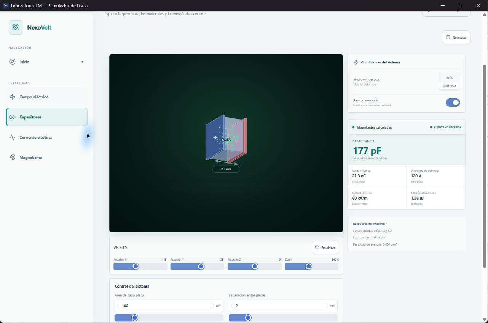
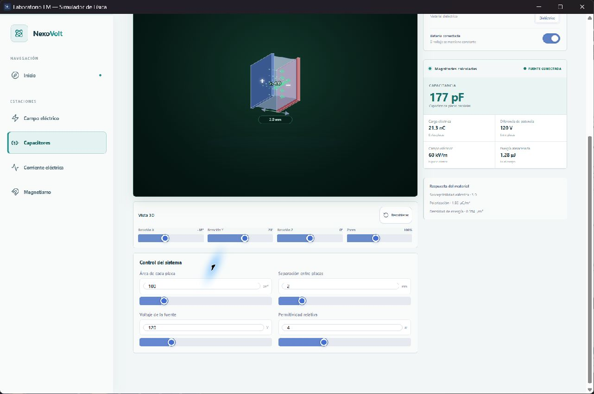
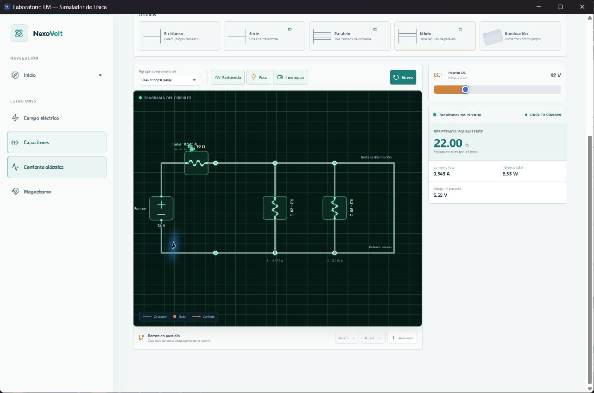
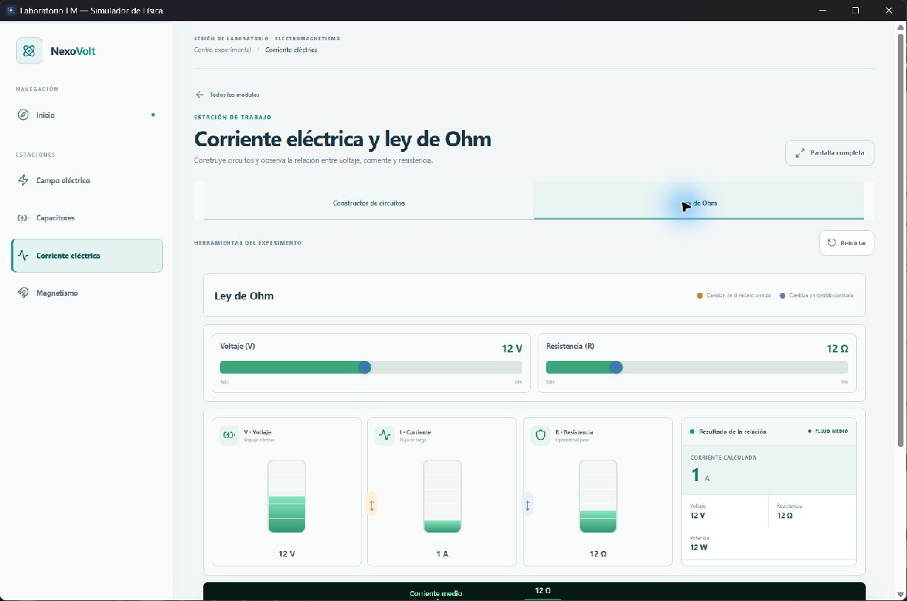
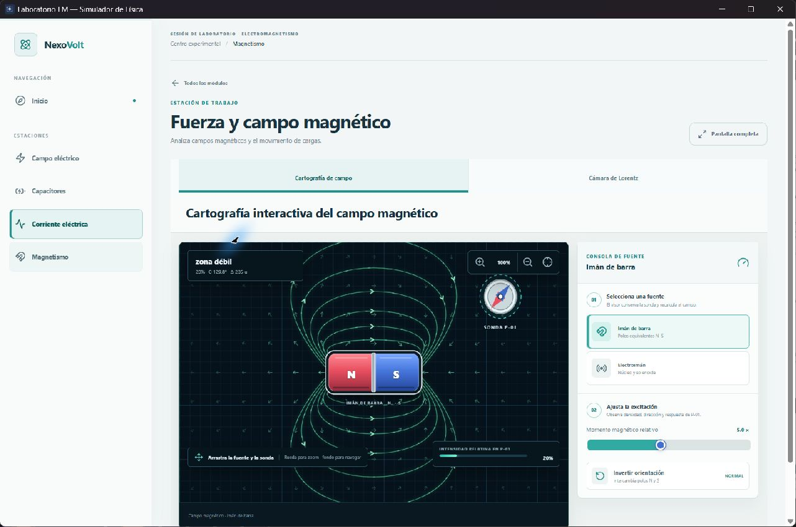
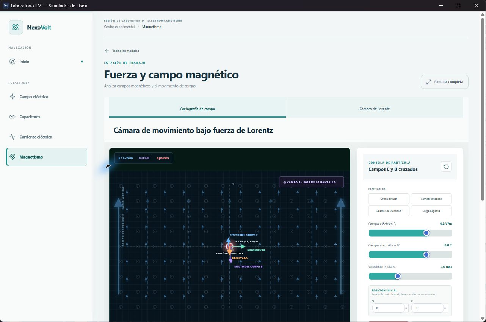

# Manual de usuario de NexoVolt

## Bienvenido al laboratorio

NexoVolt te permite experimentar con cargas eléctricas, capacitores, circuitos y campos magnéticos. Cambia un valor y observa cómo se modifican el dibujo y las lecturas. No necesitas saber programar.

Este manual te propone actividades cortas. En cada una verás qué hacer, qué resultado esperar y cómo interpretarlo. Si tu pantalla muestra valores distintos a los ejemplos, pulsa **Reiniciar** antes de comenzar.

## Conoce la pantalla

Al abrir NexoVolt verás cuatro estaciones. Entra con una tarjeta o con la barra lateral. **Inicio** y **Todos los módulos** te devuelven a esta pantalla. Dentro de algunas estaciones hay pestañas para cambiar de experiencia. **Pantalla completa** amplía el trabajo actual.

**Haz una prueba:** entra en Campo eléctrico, vuelve con Todos los módulos y abre Capacitores desde la barra lateral. La estación seleccionada queda resaltada.

Puedes escribir valores en los campos numéricos o mover los deslizadores. En los dibujos, arrastra objetos para cambiarlos de posición. Arrastra el fondo para girar o desplazar la vista cuando la estación lo permita; usa la rueda del ratón para acercar. Si pierdes el encuadre, busca **Centrar** o **Restablecer**. **Reiniciar** recupera el experimento inicial.

## Campo eléctrico y potencial

En esta estación colocas cargas y consultas qué sucede en un punto P. Las cargas positivas llevan **+** y las negativas **-**. Las líneas verdes muestran la dirección del campo: salen de las positivas y llegan a las negativas.

### Práctica 1 Dos cargas opuestas

1. Abre **Campo eléctrico** y pulsa **Reiniciar**.
2. Selecciona **Atracción** y conserva la vista **3D**.
3. Localiza la carga azul positiva, la roja negativa y el círculo del punto P.
4. Sigue las flechas verdes. Gira la escena arrastrando el fondo.
5. Pulsa **Equipotenciales** para ver zonas de igual potencial; vuelve a **Flujo del campo** para destacar la dirección.

**Observa:** las cargas no se mueven cuando giras la cámara: solo cambia el punto desde el que las miras. Las flechas apuntan de la región positiva hacia la negativa.

### Práctica 2 Mide en P

En **Cargas fuente** puedes cambiar signo, magnitud, prefijo y coordenadas. Se admiten hasta diez cargas. En **Punto P** escribes x, y, z en centímetros; las lecturas cambian al instante.

El ejemplo inicial sitúa P en `(0; 3,2; 0) cm`. El campo es cercano a `1,017 x 10^7 N/C` y el potencial a `0 V`. **N/C** expresa fuerza eléctrica por unidad de carga; **V** expresa potencial. Ex, Ey y Ez son las partes del campo en los tres ejes. Un signo negativo indica el sentido contrario al eje positivo.

**Ahora prueba tú:** cambia solo la coordenada Y de P. ¿Qué pasa con la magnitud del campo al acercarte a una carga? `1,017 x 10^7` significa 1,017 multiplicado por diez millones. `μC` significa una millonésima de culombio.

### Práctica 3 Sigue una partícula

Abre **Trayectoria de partículas**. Ajusta posición, velocidad, carga, masa y duración; luego pulsa **Iniciar recorrido**. Usa pausa y los controles de reproducción para examinar el camino. **Limpiar trayectoria** prepara otro ensayo.

La línea punteada muestra el recorrido. Las flechas junto a la partícula indican velocidad y fuerza; la gráfica inferior muestra la rapidez. Repite el ensayo con una carga móvil de signo contrario y compara hacia dónde se curva. Cambia una sola variable cada vez para entender su efecto.

## Capacitores y dieléctricos

Un capacitor guarda carga y energía entre dos placas. Puedes cambiar el área, la distancia, el voltaje y el material entre ellas. La vista 3D y los resultados responden juntos.

### Práctica 4 Separa las placas

1. Abre **Capacitores** y pulsa **Reiniciar**.
2. Conserva el área en `100 cm²`, el voltaje en `120 V` y el dieléctrico activado.
3. Observa la separación de `2 mm` y la capacitancia aproximada de `177 pF`.
4. Aumenta únicamente la separación con el deslizador.
5. Compara el dibujo y la nueva lectura.

**Observa:** al separar más las placas, la capacitancia disminuye. `pF` son picofaradios: una billonésima de faradio. También verás carga, campo y energía con sus unidades junto a cada valor.

**Segundo ensayo:** vuelve a `2 mm` y alterna **Vacío** y **Dieléctrico**. Con la batería conectada, el voltaje permanece constante; al desconectarla, la carga se conserva y el voltaje cambia. Comprueba el estado de la fuente en el panel antes de comparar. Arrastrar la vista o usar zoom solo cambia la cámara. **Restablecer** devuelve la cámara; **Reiniciar** devuelve también los valores físicos.

## Circuitos y ley de Ohm

El **Constructor de circuitos** permite crear caminos con resistencias, focos e interruptores. La pestaña **Ley de Ohm** relaciona voltaje, resistencia y corriente.

### Práctica 5 Un circuito mixto

1. Abre **Corriente eléctrica** y **Constructor de circuitos**.
2. Selecciona **Mixto**. Verás una resistencia antes de dos ramas paralelas.
3. Mantén la fuente en `12 V` y lee **Resultados del circuito**.
4. Selecciona una resistencia del dibujo, cambia su valor y vuelve a leer corriente y potencia.
5. Añade o abre un interruptor para ver qué camino deja de conducir.

Con los valores iniciales, la resistencia equivalente es `22 Ω`, la corriente total aproximadamente `0,545 A` y la potencia cercana a `6,55 W`. `Ω` se lee ohmios, `A` amperios y `W` vatios. **Circuito cerrado** indica que existe al menos un camino conductor.

Para crear el tuyo, elige **En blanco**, selecciona dónde agregar un componente y pulsa **Resistencia**, **Foco** o **Interruptor**. Usa **Añadir rama** para caminos paralelos. Las tarjetas Serie, Paralelo, Mixto e Iluminación ofrecen ejemplos preparados.

### Práctica 6 Ley de Ohm

Abre la pestaña **Ley de Ohm**. Con `12 V` y `12 Ω`, la pantalla muestra `1 A` y `12 W`. Aumenta el voltaje manteniendo la resistencia: la corriente sube. Vuelve a `12 V` y aumenta la resistencia: la corriente baja.

**Idea clave:** el voltaje impulsa la corriente y la resistencia se opone a ella. La lectura principal te permite comprobar el efecto sin hacer cálculos a mano.

## Campo magnético y fuerza

**Cartografía de campo** muestra líneas alrededor de un imán o electroimán. La sonda P-01 indica dirección e intensidad relativas donde la coloques.

### Práctica 7 Mueve la sonda

1. Selecciona **Cartografía de campo** e **Imán de barra**.
2. Acerca la sonda P-01 a un polo y observa el porcentaje.
3. Aléjala y compara la intensidad y el ángulo.
4. Pulsa **Invertir orientación** y observa el sentido de las líneas.
5. Cambia a **Electroimán** para comparar otra fuente.

El porcentaje es una intensidad relativa del dibujo, no una medida en teslas de un imán real. Arrastra el fondo para navegar y usa la rueda para acercar.

### Práctica 8 Cámara de Lorentz

Abre **Cámara de Lorentz** y elige **Órbita circular** o **Campos cruzados**. Ajusta campo eléctrico, campo magnético, velocidad, carga y masa; después reproduce el movimiento.

La pantalla distingue la fuerza eléctrica, la magnética y su resultado. Prueba una carga negativa sin cambiar los demás valores: la fuerza invierte su dirección. La trayectoria es una representación idealizada.

## Lee los resultados con confianza

Mira siempre **número, unidad y condición del experimento**. Dos cifras no se comparan bien si cambiaste varias variables a la vez. `k` significa mil, `m` milésima, `μ` millonésima, `n` milmillonésima y `p` billonésima.

Anota la estación, el valor que cambiaste, los que mantuviste, las lecturas antes y después, y una frase que explique el cambio. Por ejemplo: «Al aumentar la separación de las placas con la batería conectada, la capacitancia disminuyó».

## Si algo no sale como esperabas

- **El objeto quedó fuera de vista:** usa **Centrar** o **Restablecer**. Para recuperar todo el experimento, pulsa **Reiniciar**.
- **No circula corriente:** revisa interruptores abiertos y ramas sin componentes.
- **La trayectoria se aleja muy rápido:** reduce carga, velocidad, campo o duración.
- **La cifra parece enorme:** comprueba el exponente, el prefijo y la unidad.
- **Mover la cámara no altera la lectura:** la cámara cambia lo que ves, no los parámetros físicos.

NexoVolt sirve para estudiar tendencias en modelos ideales. Sus dibujos y lecturas no sustituyen instrumentos de medición ni cálculos de diseño de equipos reales.

## Tu ficha de observación

Elige una práctica de este manual y repítela cambiando **solo una variable**. Usa esta ficha para explicar lo que viste con tus propias palabras.

| Anota | Tu ensayo |
|---|---|
| Estación y práctica | __________________________________________ |
| Valor que cambiaste | __________________________________________ |
| Valores que mantuviste | __________________________________________ |
| Lectura inicial y unidad | __________________________________________ |
| Lectura final y unidad | __________________________________________ |
| Lo que ocurrió en el dibujo | __________________________________________ |

### Comprueba lo que aprendiste

1. ¿La lectura aumentó, disminuyó o cambió de dirección?
2. ¿Qué parte del dibujo te ayudó a entender el resultado?
3. Si repites el ensayo con el cambio contrario, ¿qué esperas que ocurra?

**Mi conclusión:** ________________________________________________________________
